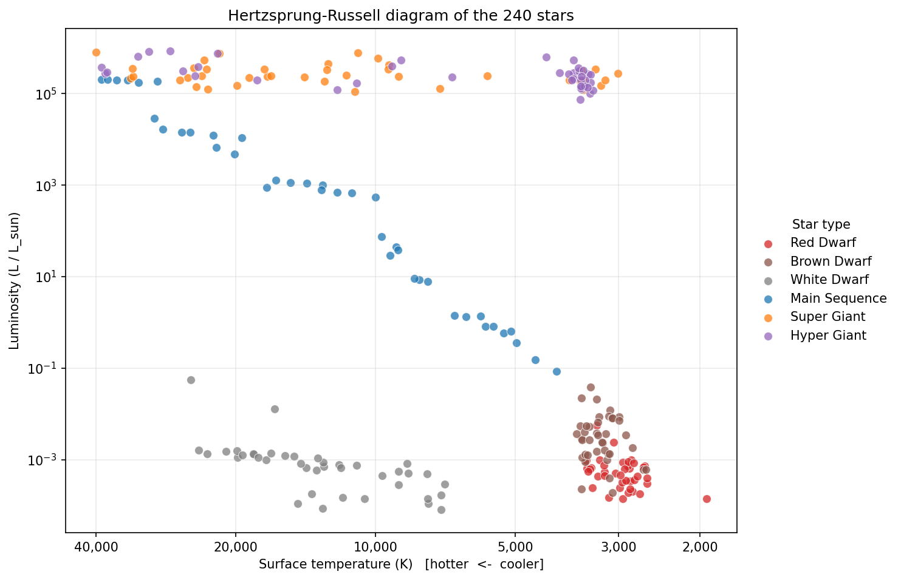

# Star Type Classification
 
Predict a star's type (red dwarf, brown dwarf, white dwarf, main sequence, super giant, hyper giant) from its physical properties, using a reproducible machine learning pipeline, an honest evaluation, and an interactive web app.
 
**Live demo:** [add your Streamlit link here]
 

*Replace with your Hertzsprung-Russell diagram from notebook 01.*
 
## Summary
 
| | |
|---|---|
| Data | 240 stars, 6 balanced classes (40 each), 6 raw features |
| Final model | Random forest on log temperature, log luminosity, log radius, absolute magnitude |
| Cross-validated accuracy | about 100% (5x5 stratified CV) |
| Held-out test | 48 of 48 correct |
| Real-star check | 8 of 11 well-known stars correct |
| Probability quality | Underconfident but well calibrated (ECE 0.021) |
 
The headline accuracy is **not** the main result. The dataset is small, balanced and not physically self-consistent, so nearly any model scores highly. The value of this project is in the analysis around the number: which features matter, why the problem is easy, where the model fails on real stars, and why.
 
## Key findings
 
1. **Radius and absolute magnitude carry the signal.** Adding log R gained about 15 accuracy points; adding magnitude gained 3 to 5. Temperature adds almost nothing once those are known.
2. **More features can hurt.** Adding color reduced KNN and SVM accuracy by 5 to 6 points; spectral class added nothing and has quality problems (24% of stars conflict with their temperature range).
3. **Log10 was the best transformation for skewed features**, chosen from eight candidates on skewness, model performance, stability and interpretability.
4. **The data is not physically consistent.** Recorded luminosity deviates from the Stefan-Boltzmann relation by up to 4 orders of magnitude.
5. **The model learned the dataset's labelling conventions, which differ from standard astronomy.** It misclassified a real red dwarf (Barnard's Star) as a brown dwarf, and two red supergiants (Antares, Betelgeuse) as hyper giants, with the supergiants flagged at low confidence.
## Pipeline
 
| Stage | Notebook | Write-up |
|---|---|---|
| 1. Data exploration | `notebooks/01_data_exploration.ipynb` | `docs/01_data_exploration.md` |
| 2. Data cleaning | `notebooks/02_data_cleaning.ipynb` | `docs/02_data_cleaning.md` |
| 3. Transformation (incl. skew comparison) | `notebooks/03_data_transformation.ipynb` | `docs/03_data_transformation.md`, `docs/03_skew_transformation.md` |
| 4. Model comparison, tuning and selection | `notebooks/04_model_comparison.ipynb` | `docs/04_model_comparison.md` |
| 5. Evaluation, explainability, real-star validation | `notebooks/05_evaluation_explainability.ipynb` | `docs/05_evaluation_explainability.md` |
| 6. Web app | `app/app.py` | this README |
 
## Repository structure
 
```
star-classification/
  README.md
  requirements.txt
  data/
    Stars.csv                    raw (never edited)
    stars_clean.csv              after cleaning
    stars_transformed.csv        after transformation
  notebooks/                     01 to 05, run in order
  docs/                          one write-up per stage
  models/
    star_classifier.joblib       final pipeline (raw inputs -> prediction)
    model_metadata.json          feature names, class names, training ranges
  reports/figures/
  app/
    app.py                       Streamlit app
```
 
## Run it locally
 
```bash
git clone <your-repo-url>
cd star-classification
python -m venv .venv
source .venv/bin/activate          # Windows: .venv\Scripts\activate
pip install -r requirements.txt
 
# reproduce the analysis: run notebooks 01 to 05 IN ORDER
# (the last cell of notebook 04 saves models/star_classifier.joblib, which
#  notebook 05 and the app both need), then
streamlit run app/app.py
```
 
## Deploy the app (free)
 
1. Push the repository to GitHub, including `models/star_classifier.joblib`, `models/model_metadata.json` and `data/stars_clean.csv`.
2. Make sure `requirements.txt` pins the **exact scikit-learn version** you trained with (`pip freeze | grep -i scikit`). A model saved with one version can fail or misbehave on another.
3. On [Streamlit Community Cloud](https://streamlit.io/cloud), choose the repository, set the main file to `app/app.py`, and deploy.
4. Paste the resulting link at the top of this README.
## The app
 
Enter temperature, luminosity, radius and absolute magnitude (or load an example star). The app returns the predicted type with class probabilities, plots the star on the HR diagram against the training data, warns when confidence is below 70%, and warns when an input lies outside the training range (tree models cannot extrapolate).
 
## Methodology highlights
 
- **No leakage:** stratified train/test split before any learning; scalers and fitted transformers live inside cross-validation pipelines; the test set was used once.
- **Repeated stratified cross-validation** (5x5) with standard deviations; differences under about 2 points are treated as noise.
- **Feature-set ablation** to decide what the app should ask users for.
- **Nested cross-validation** for tuning, optimised on log loss because accuracy was saturated.
- **Robustness testing** with injected input noise.
- **External validation** on catalogued real stars.
## Limitations
 
- Only 240 stars, with an artificial 40-per-class balance; real star populations are dominated by red dwarfs.
- Source luminosities are not consistent with physics, and class definitions follow the dataset's own conventions.
- Tree models cannot extrapolate beyond the training range.
- The real-star check uses 11 stars with approximate catalogue values; treat it as illustrative.
- This is a demonstration of a machine learning workflow, not a scientific classification tool.
## Tech stack
 
Python, pandas, NumPy, scikit-learn, SciPy, Matplotlib, Plotly, Streamlit, joblib, Jupyter.
 
## Data
 
Star Type Classification dataset (Kaggle, "Stars.csv"). Solar constants used: L☉ = 3.828 × 10^26 W, R☉ = 6.9551 × 10^8 m.
 
## Author
 
Cheni Lei M. Olanos